# ChainFlow

[](https://golang.org)
[](LICENSE)

A robust, extensible framework for building sequential processing pipelines that can enrich and validate entities through a chain of responsibility pattern, handling complex business logic while maintaining clean separation of concerns.

## Table of Contents

- [Overview](#overview)
- [Architecture](#architecture)
- [Core Components](#core-components)
- [Design Patterns](#design-patterns)
- [Installation](#installation)
- [Quick Start](#quick-start)
- [Usage Examples](#usage-examples)
- [API Reference](#api-reference)
- [Best Practices](#best-practices)
- [Contributing](#contributing)

## Overview

The ChainFlow provides a flexible way to build processing pipelines where:

- Each processor has a single responsibility
- Processors can be chained in any order
- Chain execution can be terminated gracefully
- Type safety is maintained throughout the pipeline
- Error handling is consistent and predictable

### Key Benefits

- **🔗 Flexible Chaining**: Combine processors in any sequence
- **🛡️ Type Safety**: Generic constraints ensure compile-time safety
- **🚫 Graceful Termination**: Break chains without error propagation
- **🔄 Reusable Components**: Same processors in different chains
- **⚡ Fail Fast**: Early validation prevents unnecessary processing
- **🧪 Testable**: Each processor can be tested independently

## Architecture

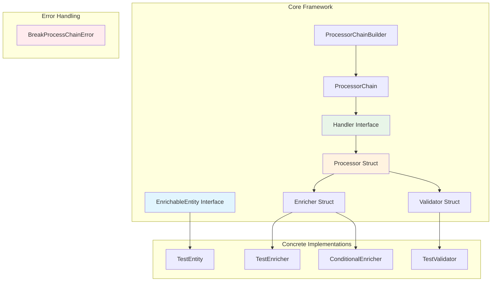

## Core Components

### Component Hierarchy

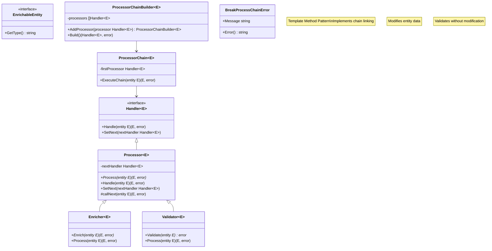

### Interface Definitions

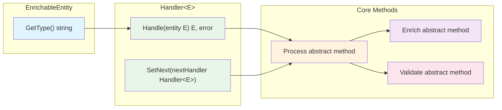

## Design Patterns

### Template Method Pattern

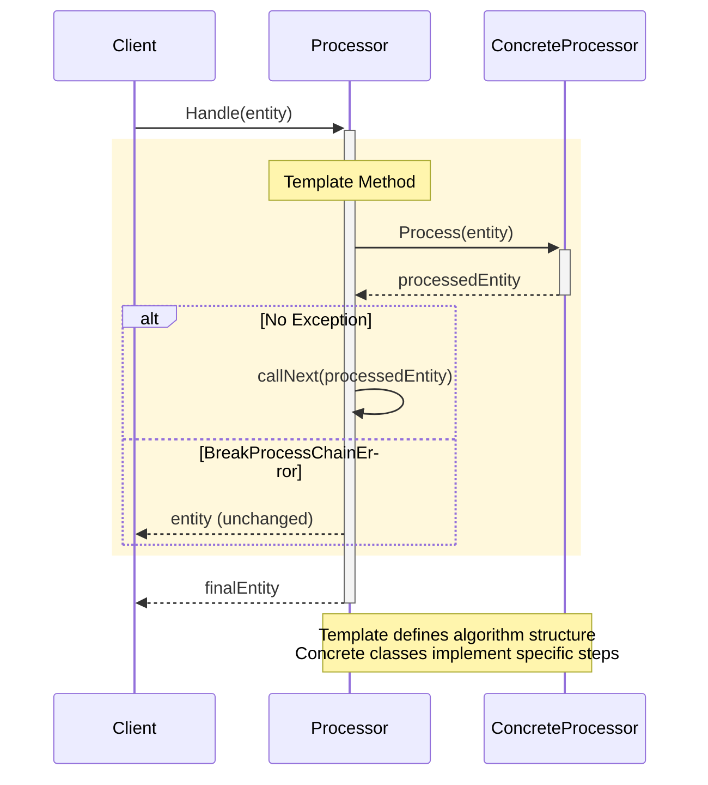

### Chain of Responsibility

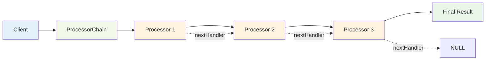

## Installation

```bash
# Clone the repository
git clone https://github.com/netologist/chainflow.git

# Navigate to the project directory
cd processor-chain-go

# Initialize Go module
go mod init processor-chain

# Run the example
go run main.go
```

### Requirements

- Go 1.18 or higher (for generics support)
- No external dependencies

## Quick Start

### Basic Usage

```go
package main

import (
    "fmt"
)

func main() {
    // Create processors
    enricher1 := NewTestEnricher(" - Step1")
    validator := NewTestValidator("validation", true)
    enricher2 := NewTestEnricher(" - Step2")

    // Build the chain
    builder := NewProcessorChainBuilder[*TestEntity]()
    firstProcessor, err := builder.
        AddProcessor(enricher1).
        AddProcessor(validator).
        AddProcessor(enricher2).
        Build()

    if err != nil {
        panic(err)
    }

    // Create and execute chain
    chain := NewProcessorChain(firstProcessor)
    entity := &TestEntity{Data: "Initial Data"}
    
    result, err := chain.ExecuteChain(entity)
    if err != nil {
        fmt.Printf("Error: %v\n", err)
        return
    }
    
    fmt.Printf("Result: %s\n", result)
    // Output: Result: TestEntity{Data: Initial Data - Step1 - Step2}
}
```

## Usage Examples

### 1. Normal Chain Execution

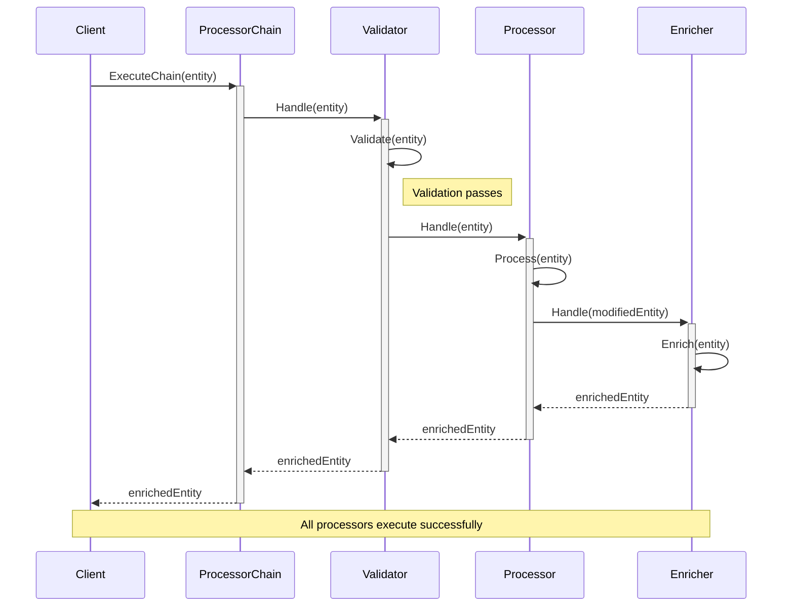

### 2. Chain Breaking Scenario

```mermaid
sequenceDiagram
    participant Client
    participant Chain as ProcessorChain
    participant V as Validator
    participant P as Processor
    participant E as Enricher
    
    Client->>+Chain: ExecuteChain(entity)
    Chain->>+V: Handle(entity)
    
    V->>V: Validate(entity)
    V->>V: throw BreakProcessChainError
    
    rect rgb(255, 235, 238)
        Note over V: Template Method catches exception
        V->>V: return entity (unchanged)
    end
    
    V-->>-Chain: entity (unchanged)
    Chain-->>-Client: entity (unchanged)
    
    Note over P,E: These processors are never called
    
    style V fill:#ffcdd2
```

### 3. Validation Failure

```go
// Example: Validation that fails
validator := NewTestValidator("strict validation", false)

chain := NewProcessorChainBuilder[*TestEntity]().
    AddProcessor(NewTestEnricher(" - Before")).
    AddProcessor(validator).
    AddProcessor(NewTestEnricher(" - After")).
    Build()

result, err := chain.ExecuteChain(entity)
if err != nil {
    fmt.Printf("Validation failed: %v\n", err)
    // Output: Validation failed: invalid entity validator: strict validation
}
```

### 4. Conditional Processing

```go
// Custom processor that conditionally breaks the chain
type ConditionalProcessor struct {
    Processor[*TestEntity]
}

func (cp *ConditionalProcessor) Process(entity *TestEntity) (*TestEntity, error) {
    if entity.Data == "STOP" {
        return entity, &BreakProcessChainError{Message: "Processing stopped"}
    }
    return &TestEntity{Data: entity.Data + " - Processed"}, nil
}
```

## API Reference

### Core Types

#### EnrichableEntity
```go
type EnrichableEntity interface {
    GetType() string
}
```

#### Handler[E EnrichableEntity]
```go
type Handler[E EnrichableEntity] interface {
    Handle(entity E) (E, error)
    SetNext(nextHandler Handler[E])
}
```

#### Processor[E EnrichableEntity]
```go
type Processor[E EnrichableEntity] struct {
    nextHandler Handler[E]
}

func (p *Processor[E]) Handle(entity E) (E, error)
func (p *Processor[E]) SetNext(nextHandler Handler[E])
func (p *Processor[E]) Process(entity E) (E, error) // Abstract method
```

### Builder Pattern

#### ProcessorChainBuilder[E EnrichableEntity]
```go
func NewProcessorChainBuilder[E EnrichableEntity]() *ProcessorChainBuilder[E]
func (b *ProcessorChainBuilder[E]) AddProcessor(processor Handler[E]) *ProcessorChainBuilder[E]
func (b *ProcessorChainBuilder[E]) Build() (Handler[E], error)
```

### Error Handling

#### BreakProcessChainError
```go
type BreakProcessChainError struct {
    Message string
}

func (e *BreakProcessChainError) Error() string
```

## Execution Flow

### Complete Chain Execution Flow

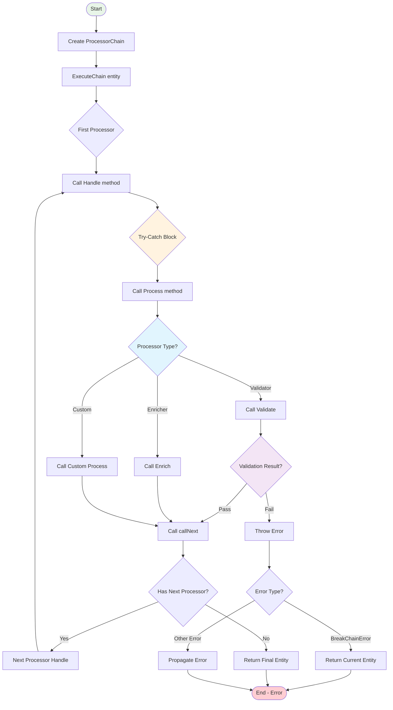

## Best Practices

### 1. Design Guidelines

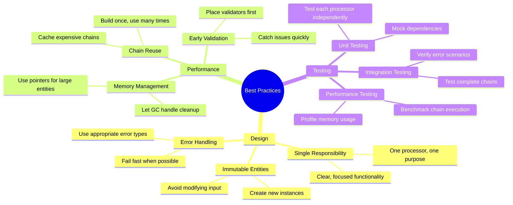

### 2. Processor Ordering Strategy

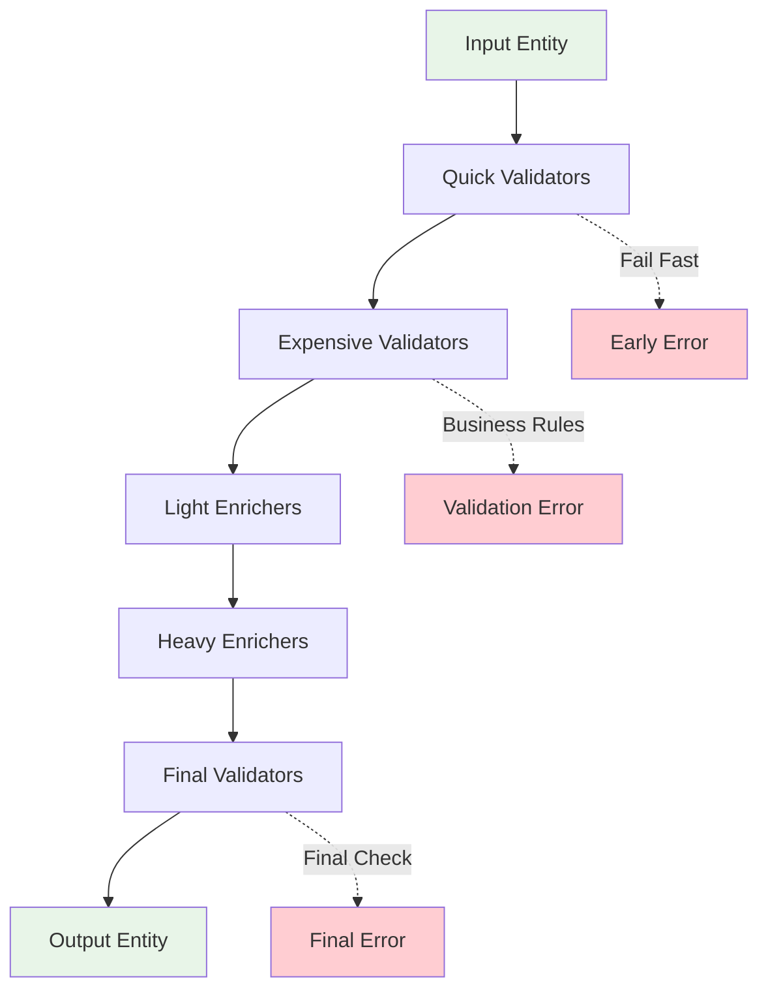

### 3. Error Handling Strategy

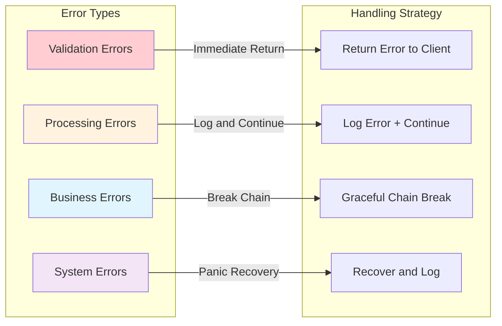

## Performance Considerations

### Memory Usage Patterns

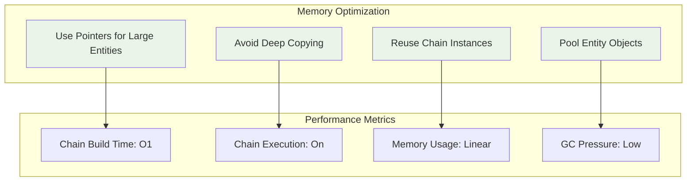

## Contributing

We welcome contributions! Please see our [Contributing Guidelines](CONTRIBUTING.md) for details.

### Development Setup

```bash
# Fork and clone the repository
git clone https://github.com/netologist/chainflow.git

# Create a feature branch
git checkout -b feature/your-feature-name

# Make your changes and add tests
go test ./...

# Submit a pull request
```

### Code Style

- Follow Go conventions and use `gofmt`
- Write comprehensive tests for new features
- Document public APIs with Go doc comments
- Use meaningful commit messages

## License

This project is licensed under the MIT License - see the [LICENSE](LICENSE) file for details.

## Changelog

See [CHANGELOG.md](CHANGELOG.md) for details about changes in each version.

---

**Questions?** Open an issue or start a discussion in our [GitHub Discussions](https://github.com/netologist/chainflow/discussions).
